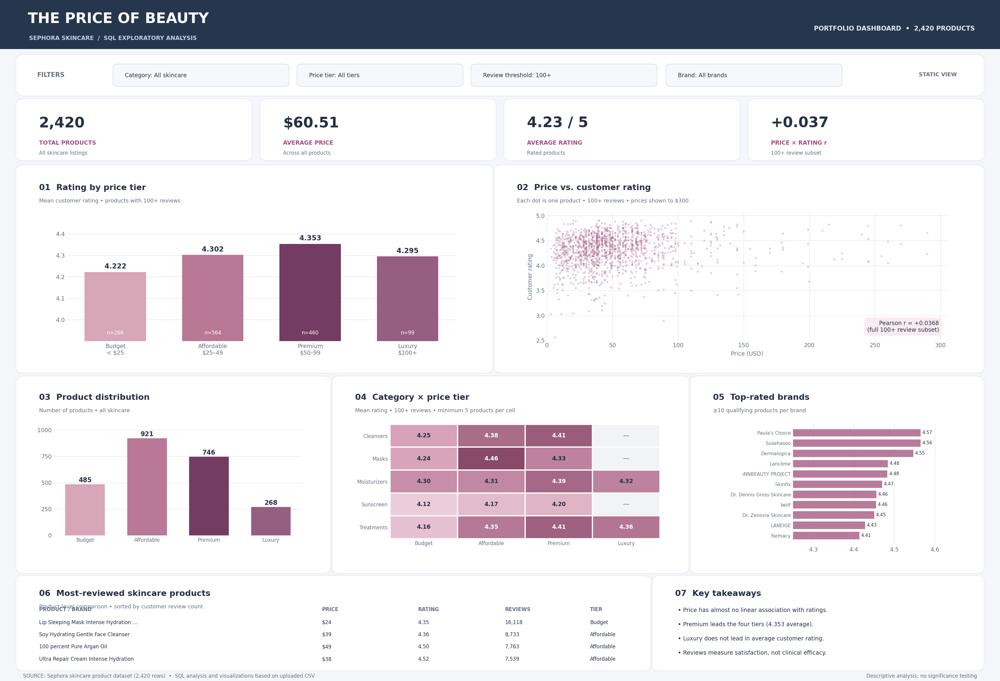

# The Price of Beauty 💗
### Does Expensive Skincare Actually Get Better Reviews?

**A MySQL exploratory analysis of 2,420 Sephora skincare products**, examining whether higher prices are associated with higher customer ratings, how satisfaction varies across price tiers, and which brands perform best among well-reviewed products.



> **Dashboard note:** This is a static, Tableau-inspired visualization created from the cleaned product-level CSV. The filter controls shown in the image are decorative, not interactive.

## Project at a glance

| Metric | Result |
|---|---:|
| Skincare products analyzed | 2,420 |
| Average listed price | $60.51 |
| Average customer rating | 4.23 / 5 |
| Pearson correlation, price vs. rating (100+ reviews) | +0.0368 |

## Business question

**Does paying more for skincare translate into better customer reviews?**

To explore this question, I compared customer ratings and prices across four price segments, examined variation by skincare category, and ranked brands using minimum product and review-count thresholds.

## Tools and techniques

- **MySQL 8:** data exploration, `GROUP BY`, conditional aggregation, `HAVING`, CTEs, and `DENSE_RANK()` window functions
- **Data preparation:** numeric casting, handling missing ratings, price-tier classification, and review-count thresholds
- **Visualization:** static Tableau-style dashboard built from cleaned product data

## Key findings

### 1. Higher prices are not strongly associated with higher ratings

Among products with **at least 100 reviews**, the Pearson correlation between listed price and average customer rating was **r = +0.0368**. This is a near-zero linear association in this dataset.

### 2. Premium skincare leads on average rating—not luxury

For products with at least 100 reviews:

| Price tier | Price range | Products | Average rating |
|---|---|---:|---:|
| Budget | Under $25 | 266 | 4.222 |
| Affordable | $25–$49.99 | 564 | 4.302 |
| **Premium** | **$50–$99.99** | **460** | **4.353** |
| Luxury | $100+ | 99 | 4.295 |

The differences are relatively small and were **not tested for statistical significance**. These findings describe review patterns, not causal effects of pricing.

### 3. Customer ratings vary across skincare categories

In the category-by-tier comparison (100+ reviews per product; at least five products per cell), the premium tier had the highest mean rating in **four of five** categories examined: cleansers, moisturizers, sunscreen, and treatments. Affordable products led among masks.

### 4. Brand rankings require sufficient review evidence

To avoid ranking brands based on only a handful of products, I required **at least 10 qualifying products per brand**, each with **100+ reviews**. Paula's Choice and Sulwhasoo tied for the highest rounded average rating (**4.565/5**), followed by Dermalogica (**4.547/5**).

## Methodology

1. Filtered the original Sephora products dataset to the **Skincare** primary category.
2. Cleaned and cast price, rating, and review-count fields into numeric types.
3. Assigned price tiers: Budget (<$25), Affordable ($25–<$50), Premium ($50–<$100), and Luxury ($100+).
4. Calculated descriptive statistics across **all 2,420 products**.
5. Applied a **100-review minimum** to rating comparisons to reduce the influence of sparsely reviewed products.
6. Used CTEs and a window function to rank qualifying brands.
7. Created a static dashboard with KPI cards, tier ratings, price–rating scatterplot, product distribution, category heatmap, brand ranking, and product comparison table.

**Interpretation note:** Customer ratings measure reported satisfaction, not ingredient quality, clinical effectiveness, or product safety. The analysis is observational and does not establish causality.

## Repository structure

```text
sephora-skincare-sql-analysis/
├── README.md
├── data/
│   └── sephora_skincare_clean.csv
├── images/
│   └── sephora_tableau_style_dashboard.png
└── sql/
    ├── 00_setup.sql
    └── 01_analysis.sql
```

## How to reproduce the analysis

1. Download or clone this repository.
2. Open **MySQL Workbench** and run `sql/00_setup.sql` to create the schema and table.
3. Import `data/sephora_skincare_clean.csv` into `sephora_portfolio.skincare_products` using Workbench's **Table Data Import Wizard**, or adapt the commented `LOAD DATA LOCAL INFILE` command in the setup script.
4. Verify that the imported table contains **2,420 rows**.
5. Run `sql/01_analysis.sql` to reproduce the summary tables and rankings.

The dashboard is a saved image, not a live MySQL or Tableau connection.

## Dataset credit

**Sephora Products and Skincare Reviews** — [Kaggle dataset by nadyinky](https://www.kaggle.com/datasets/nadyinky/sephora-products-and-skincare-reviews). This repository includes a skincare-only, cleaned product extract for reproducibility. Dataset credit belongs to its original publisher.

## Possible next steps

- Compare ratings within narrower product categories and price bands.
- Test whether differences in average ratings are statistically significant.
- Incorporate ingredients or product attributes to explore what else may relate to customer satisfaction.
